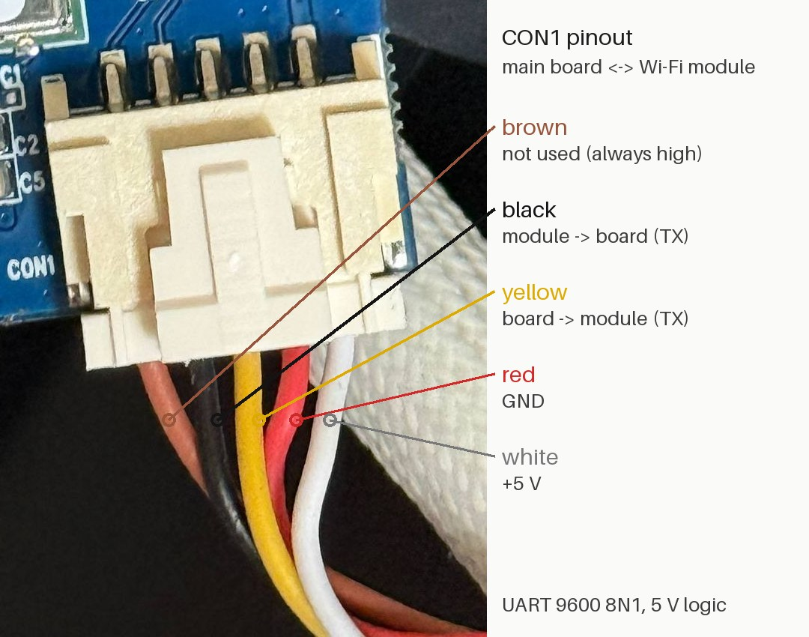

# dishSniffer: local control of a Samsung dishwasher

An **M5Stack Atom Lite** (ESP32) clipped onto the serial bus between the main board of a **Samsung DW60A8050**
dishwasher and its Wi-Fi module (**CWAP210M**). It reads everything the board says and can send commands, with the
original Wi-Fi module **still connected** (SmartThings keeps working). Everything shows up in **Home Assistant**
through MQTT discovery: no cloud, no SmartThings API.

What you get:

- **State**: idle / running / paused / delayed start, program, phase (pre-wash, wash, rinse, drying…), progress %,
  minutes elapsed and remaining, delayed-start minutes, door, baskets, Speed Booster, armed for remote control.
- **Energy**: kWh of the current wash, plus the end-of-cycle report (energy, wash and rinse temperatures).
- **Commands**: start, pause, resume, cancel, program, baskets (the dishwasher must be armed with *Smart Control*,
  exactly as SmartThings requires).
- **Debug**: raw frames, a log of every status byte that changes, optional capture to files in Home Assistant.

The protocol (a Midea "E1" UART protocol) is documented in [docs/PROTOCOL.md](docs/PROTOCOL.md).

> Entity names and code comments are in Italian (the author's language). The README and the protocol are in English.

## Hardware

- M5Stack Atom Lite (any ESP32 works; pins below are the Atom's).
- 5 jumper wires. No other components.

The bus is the 5-wire cable that goes into **CON1** of the Wi-Fi module, inside the control panel in the door.
On the DW60A8050 the panel comes off after removing the Torx T15 screws on the inside of the door (see the service
manual of your model).




| CON1 wire | Function | Atom Lite |
|---|---|---|
| red | GND | GND |
| white | +5 V | 5V (the Atom is powered by the dishwasher) |
| yellow | TX board → module | **G22** |
| black | TX module → board (open-drain, pulled up to 5 V) | **G19** |
| brown | static high | G23 (optional, only monitored) |

Connect the Atom **in parallel**: tap the wires, leave the module plugged in.

⚠️ Read before wiring:

- The lines are 5 V and the ESP32 is a 3.3 V part that is not specified as 5 V tolerant. This setup has been running
  directly connected for weeks, but a **series resistor (1–10 kΩ)** on each data line is the cautious choice.
- **Never put a resistor to ground** on the lines (e.g. a 1 k + 2 k divider): the extra load broke the communication
  and the dishwasher dropped off SmartThings until the module was reset.
- The Atom transmits on the black line in **open-drain** mode, with the lowest drive strength, only after 1 s of
  silence on the bus. It can only pull the line low, never push it against the module. The `sonda` command (below)
  checks this on your unit before any transmission.
- You are working inside a mains appliance: unplug it before opening the panel. Your risk, your warranty.

## Firmware

Arduino, ESP32 core **2.0.17** (M5Atom does not build on 3.x), libraries **M5Atom**, **FastLED 3.6.0**, **PubSubClient**.

```sh
cp dishSniffer/secrets.example.h dishSniffer/secrets.h     # Wi-Fi, MQTT user/password, broker address
arduino-cli compile --fqbn esp32:esp32:m5stack-atom dishSniffer --output-dir build
arduino-cli upload  --fqbn esp32:esp32:m5stack-atom -p /dev/ttyACM0 dishSniffer   # first time, via USB
```

Later updates go over the air (hostname `dishsniffer`, port 3232):
`python3 ~/.arduino15/packages/esp32/hardware/esp32/2.0.17/tools/espota.py -i <atom-ip> -p 3232 -f build/dishSniffer.ino.bin`

OTA has no password: keep the Atom on a trusted network.

## Home Assistant

1. An MQTT broker (the **Mosquitto** add-on) and the **MQTT** integration. Create a Home Assistant user for the Atom and
   put it in `secrets.h`.
2. Power the Atom: the device **"Lavastoviglie (sniffer bus Wi-Fi)"** appears by itself (MQTT discovery), with
   sensors, buttons (Avvia, Pausa, Riprendi, Annulla) and selects (Programma, Cestelli).
3. Optional, in [homeassistant/](homeassistant/):
   - [dashboard-example.yaml](homeassistant/dashboard-example.yaml): a ready-made view (state, controls, last wash);
   - [automations/](homeassistant/automations/): "goodnight" script + automation that start the dishwasher N hours
     later if it is armed;
   - [pyscript/](homeassistant/pyscript/) (needs the [pyscript](https://github.com/custom-components/pyscript)
     integration): `trama_lavastoviglie.py` writes every frame to `/config/lavastoviglie/catture/YYYYMMDD.txt`
     (30 days); `lavastoviglie_energia.py` turns the per-wash energy into an ever-increasing
     `sensor.lavastoviglie_energia` for the Energy dashboard.

### Main entities

| Entity | |
|---|---|
| `sensor.…_stato_bus` | Ferma / In funzione / In pausa / Partenza ritardata |
| `sensor.…_programma_bus`, `…_fase_bus` | program, phase |
| `sensor.…_minuti_alla_fine_bus`, `…_minuti_trascorsi_bus`, `…_avanzamento_bus` | minutes left / elapsed, progress |
| `binary_sensor.…_armata_da_remoto_bus` | armed (Smart Control) |
| `binary_sensor.…_porta_bus` | door |
| `sensor.…_energia_lavaggio_in_corso` | kWh of the current wash |
| `sensor.…_ultimo_lavaggio_*` | end-of-cycle report: energy, temperatures, raw fields |
| `button.…_avvia / _pausa / _riprendi / _annulla` | commands |
| `select.…_programma`, `select.…_cestelli` | program, baskets |
| `sensor.…_ultimo_comando` | result of the last command (echo seen + board answered) |
| `switch.…_registra_trama`, `number.…_baud`, `switch.…_segnale_invertito` | debug |

(`…` = `lavastoviglie_sniffer_bus_wi_fi`)

### MQTT topics

| Topic | |
|---|---|
| `dish/stato` | decoded state, JSON (retained) |
| `dish/energia`, `dish/ciclo` | current-wash energy, end-of-cycle report (retained) |
| `dish/capture` | every frame: `<millis> G22\|G19 <gap_ms> <hex>` |
| `dish/log` | one line per changed status byte, module commands, door events |
| `dish/tx/cmd` | `sonda`, `stato`, `avvia`, `annulla`, `pausa`, `riprendi`, `programma XX`, `cestelli ZZ` (hex); never retained |
| `dish/tx/esito` | result of the last transmission (retained) |
| `dish/stats`, `dish/status` | diagnostics, online/offline |

`sonda` pulls the black line low for 20 µs (shorter than half a bit, the board ignores it) and checks that it actually
goes low. `stato` sends the module's own status query: if the board answers, transmission works.

## Other models

The CWAP210M and this E1 protocol are used on other Samsung (Midea-made) dishwashers: the decoder logs every unknown
message once on `dish/log`, which is a good starting point. Issues and pull requests with captures from other models
are welcome.

## License

MIT, see [LICENSE](LICENSE). Not affiliated with Samsung or Midea; trademarks belong to their owners.
