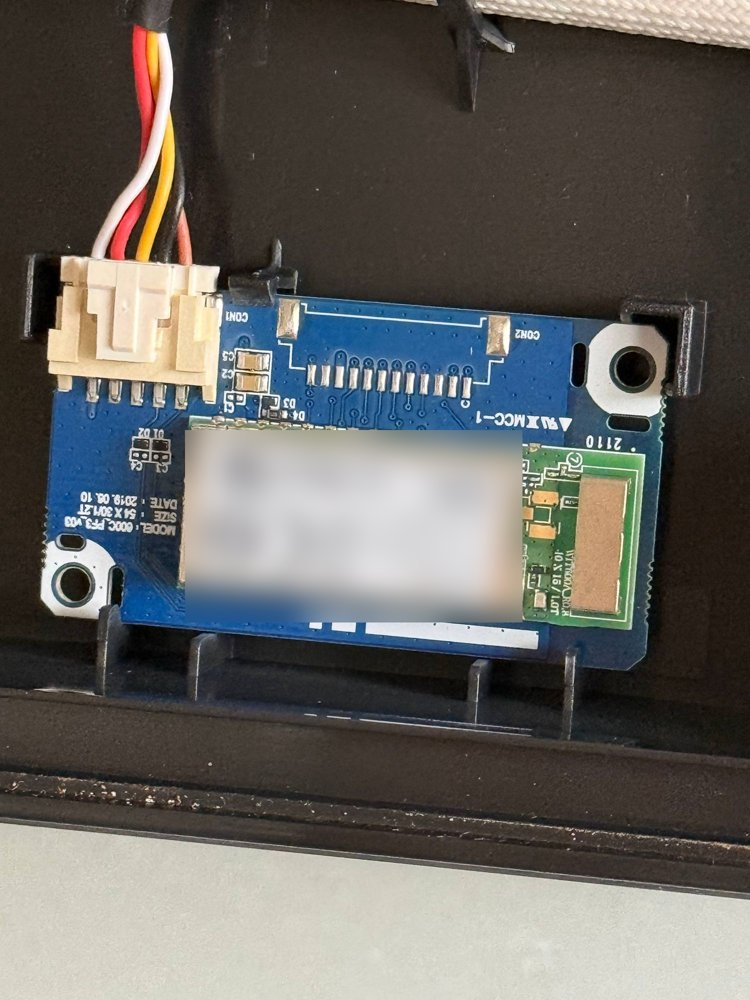

# dishSniffer: local control of a Samsung dishwasher

> **Built for one specific machine**: a Samsung **DW60A8050BB** dishwasher with the **CWAP210M** Wi-Fi module
> (main board made by Midea). I am publishing it in case it works, or helps, on other models: other Samsung
> dishwashers with the same module and the same Midea "E1" protocol are good candidates, but **nothing here has been
> tested on anything else**. If you try it on another model, captures and pull requests are very welcome.

An **M5Stack Atom Lite** (ESP32) wired **in parallel** to the serial bus between the dishwasher's main board and its
Wi-Fi module. It decodes everything the board says and can send commands, while the original module **stays
connected**. Everything shows up in **Home Assistant** via MQTT discovery: no cloud, no SmartThings.

## Why

My washer and dryer run fully local in Home Assistant through **LocalThings**, which talks to Samsung appliances
on the LAN. **My dishwasher model is not supported by LocalThings** (other Samsung dishwashers may be): on mine the
Wi-Fi module only works through the SmartThings cloud.
That left SmartThings as the only way to read or start it, and the **SmartThings API was going to become a paid
service**. I did not want the "start the dishwasher an hour after goodnight" automation to depend on a cloud
subscription, so I opened the door panel and asked Claude to take it from there.

## Who did what

**This one was done by [Claude](https://claude.com/claude-code)** (Anthropic's AI, working in Claude Code on my
Home Assistant machine): finding references, choosing the wiring, writing and flashing every firmware version over the
air, decoding the protocol from the captures, the Home Assistant integration, dashboards and automations, and this
README. **My part was the hands**: opening the door, identifying the wires with a multimeter, soldering, taking the
photos, and pressing buttons, opening the door and starting washes when Claude asked for it. In the story below,
"we" is the two of us.

## The story

### 1. Five wires

Under the door panel, next to the control board, sits a small blue board: the Wi-Fi module, a **CWAP210M**
(MediaTek MT7686 inside). A 5-wire cable goes into its connector **CON1**: white, red, yellow, black, brown.
A multimeter says: red is ground, white is +5 V, the other three are 5 V logic. Two of them should be a UART.



### 2. Listen first, and the first mistake

The first sniffer was an Atom Lite that only **listens**, with a "safe" level shifter on every line: a 1 kΩ + 2 kΩ
divider, 5 V → 3.3 V. It did not last long. The extra 3 kΩ to ground on each line was enough load
that the board stopped answering the module: the dishwasher dropped off SmartThings, and the module had to be reset
and paired again.

> **Lesson**: on this bus, never put a resistor to ground. A series resistor is fine; a load is not.

The Atom was then wired directly (it has been running like that since). On the first capture:

```
G22  AA 0B E1 EA 00 00 01 00 00 63 00 C6                               ← every 15 s
G19  AA 14 E1 00 00 00 00 00 00 63 03 44 01 04 A8 C0 01 00 01 00 F2    ← ~90 ms later
```

`AA … E1`, a length byte, and a checksum that is the two's complement of the sum. This is a **Midea UART protocol**,
device type **E1** (dishwasher). The board asks *"how is the network?"* (`63`) every 15 seconds; the module answers
with its IP backwards, `04 A8 C0` + `01` = 192.168.4.1, because right after the reset it was in pairing (AP) mode.
That fixed the wiring for good: **yellow = board → module**, **black = module → board**, brown is a static line.


### 3. Pressing buttons for science

Then came a long session of pressing panel buttons, changing programs, opening the door and starting cycles from the
app, while the firmware logged **every byte of the status that changed**:

```
LOG evento porta/pannello: 01     ← Smart Control pressed
LOG evento porta/pannello: 05     ← door open
LOG evento porta/pannello: 04     ← door closed
LOG stato byte 9: 00 -> 01        ← armed for remote control
```

The status is a 24-byte body: state, minutes left, program, baskets, delay, Speed Booster, and byte 9 is the
**"armed"** flag. That flag matters: Samsung only accepts remote commands after you open the door, press
*Smart Control* and close it again within a few seconds. Starting, cancelling and changing program from SmartThings showed the
commands on the black wire:

```
G19  AA 10 E1 00 00 00 00 00 00 02 02 01 00 00 00 00 0A    ← start
G19  AA 10 E1 00 00 00 00 00 00 02 02 05 00 00 00 00 06    ← cancel
G19  AA 10 E1 00 00 00 00 00 00 02 03 09 00 00 00 00 01    ← program = Express 60°
```

### 4. A night wash, byte by byte

An overnight **Intensive 65°** with the sniffer recording gave the phases (pre-wash, wash, rinse, drying, end; the door
pops open by itself at the end) and two surprises. The first is a counter that grows at every phase:

```
G22  … 03 02 1A 07 00 00 1A 08 00 00 1A 09 00 00 1A 0A 00 00 1A 0B 00 13 3B    ← 0x13 = 19
G22  … 04 02 1A 07 00 00 1A 08 00 00 1A 09 00 00 1A 0A 00 00 1A 0B 00 51 F9    ← 0x51 = 81
```

`1A0B` went 19 → 81 → 120 → 150: energy in **10 Wh** units, **1.50 kWh** at the end (a second wash later showed it is a
running total, not per wash: see step 7)
(SmartThings, for the same wash, showed +1.33 kWh in 0.33 kWh steps). The second surprise arrived at 02:12, four
messages starting with `0A seq 46`:

```
G22  … 03 0A 01 46 02 13 70 04 FC FC FC FC 71 01 A7 72 01 12 73 01 22 80 02 00 F2 81 01 01 …
G22  … 03 0A 02 46 00 85 01 03 86 02 00 E6 87 02 02 8A 88 02 02 44 89 01 00 90 01 00 …
```

Concatenated, it is a list of 19 `tag, length, value` items: an **end-of-cycle report**. `93` = 1500 Wh,
`87` = `02 8A` = 650 → **65.0 °C** (it was a 65° program), `88` = 58.0 °C (rinse?), `86` = 23.0 °C (inlet water?).
The rest is still unknown.

### 5. Can we talk without breaking it again?

Reading was done. Writing on the black wire meant sharing a line the module already drives, and we did not want to
repeat step 2. If the module drives the line push-pull, a second driver fights it. If the line is **open-drain with a
pull-up**, anyone can pull it low safely.

So the firmware got a `sonda` (probe) command: switch G19 to open-drain at the **lowest drive strength**, pull it low
for **20 µs** (less than half a bit at 9600 baud, so the board ignores it) and read the pin back:

```
TX sonda: il nero scende: open-drain, si puo trasmettere (scesa 5 volte su 5 con corrente minima)
```

It went low 5 times out of 5 and came straight back up: a pull-up, not a push-pull driver. Next step: send the
**module's own status query**, the most harmless message there is, after 1 s of silence on the bus:

```
G19  AA 12 E1 00 00 00 00 00 00 03 01 00 00 00 00 00 00 00 09     ← sent by the Atom
G22  AA 22 E1 C3 00 00 00 00 00 03 01 01 00 00 00 00 D2 02 04 …   ← board answers 56 ms later
```

### 6. Start

With the dishwasher armed:

```
G19  AA 10 E1 00 00 00 00 00 00 02 02 01 00 00 00 00 0A                                     ← Atom: start
G22  AA 22 E1 C3 00 00 00 00 00 02 01 02 00 00 00 00 D2 02 04 01 00 00 00 00 00 00 01 …   ← state 02, 210 min, pre-wash
```

It started. Cancel, pause, resume, program and baskets followed the same way. One accident on the way: while hunting
for the Speed Booster command, `04 01` **started a wash** (Auto program). It was cancelled within a minute and is
now documented as *do not use*.

### 7. A second wash, and a wrong guess

An **Auto 45-65° with Sanitize** (19/11) corrected me twice. `1A0B` did not start from zero: it went on from 194 to 349,
and the 155 difference (1.55 kWh) is exactly the `93` of that wash's report, so the counter is a **running total** and the
energy of a wash is its increase. The door opened by itself 10 minutes before the end, but the board never sent `05`:
during drying it only sends `01`, which elsewhere just means "panel on". And toggling *auto door release* in SmartThings
showed one more command on the black wire:

```
G19  AA 10 E1 00 00 00 00 00 00 02 01 02 01 00 00 00 09    ← auto door release OFF   (status byte 22: 04 → 06)
G19  AA 10 E1 00 00 00 00 00 00 02 01 02 00 00 00 00 0A    ← auto door release ON    (status byte 22: 06 → 04)
```

The report also showed Sanitize pushing the final rinse from 58 to **70 °C**, and tag `80` counting the completed washes.
Firmware 2.5 has all of it, including the switch for the auto door release.

The SmartThings integration is still installed for comparison, but nothing in my Home Assistant uses it any more.

## Not sure how to install it?

If the steps below are not enough, give [docs/INSTALL-WITH-CLAUDE.md](docs/INSTALL-WITH-CLAUDE.md) to your own
Claude (or another AI assistant), together with a link to this repository. It is written for the assistant: it asks
you the right questions, checks your model and your wiring before anything is powered, and walks you through
flashing, Home Assistant and the first test one step at a time, listen-only first.

## What you get

- **State**: idle / running / paused / delayed start, program, phase, progress %, minutes elapsed and left, delay,
  door (also when it opens by itself), baskets, Speed Booster, Sanitize, armed.
- **Energy**: the board's energy counter, the end-of-cycle report (energy, wash and rinse temperatures, completed washes)
  and, with the pyscript, the kWh of the current wash.
- **Commands**: start, pause, resume, cancel, program, baskets (only when armed, exactly like SmartThings), auto door
  release on/off.
- **Debug**: raw frames, a log of every status byte that changes, optional capture to files in Home Assistant.

The full protocol is in [docs/PROTOCOL.md](docs/PROTOCOL.md). The annotated night wash, in Italian, is in
[docs/analisi-20261118.md](docs/analisi-20261118.md).

> Entity names and code comments are in Italian (my language). The README and the protocol are in English.

## Hardware

- M5Stack Atom Lite (any ESP32 works; pins below are the Atom's).
- 5 jumper wires. No other components.

| CON1 wire | Function | Atom Lite |
|---|---|---|
| red | GND | GND |
| white | +5 V | 5V (the Atom is powered by the dishwasher) |
| yellow | TX board → module | **G22** |
| black | TX module → board (open-drain, pulled up to 5 V) | **G19** |
| brown | static high | G23 (optional, only monitored) |

Connect the Atom **in parallel**: tap the wires, leave the module plugged in. On the DW60A8050 the control panel comes
off after removing the Torx T15 screws on the inside of the door (check the service manual of your model).

⚠️ Read before wiring:

- The lines are 5 V and the ESP32 is a 3.3 V part, not specified as 5 V tolerant. Mine runs directly connected
  (since November 2026), but a **series resistor (1–10 kΩ)** on each data line is the cautious choice.
- **Never put a resistor to ground** on the lines (see step 2 above).
- The Atom transmits on the black line in **open-drain**, with the lowest drive strength, only after 1 s of silence.
  Run `sonda` on your unit before any other transmission.
- You are working inside a mains appliance: unplug it before opening the panel. Your risk, your warranty.

## Firmware

Arduino, ESP32 core **2.0.17** (M5Atom does not build on 3.x), libraries **M5Atom**, **FastLED 3.6.0**, **PubSubClient**.

```sh
cp dishSniffer/secrets.example.h dishSniffer/secrets.h     # Wi-Fi, MQTT user/password, broker address
arduino-cli compile --fqbn esp32:esp32:m5stack-atom dishSniffer --output-dir build
arduino-cli upload  --fqbn esp32:esp32:m5stack-atom -p /dev/ttyACM0 dishSniffer   # first time, via USB
```

Later updates go over the air (hostname `dishsniffer`, port 3232):
`python3 ~/.arduino15/packages/esp32/hardware/esp32/2.0.17/tools/espota.py -i <atom-ip> -p 3232 -f build/dishSniffer.ino.bin`

OTA has no password: keep the Atom on a trusted network.

## Home Assistant

1. An MQTT broker (the **Mosquitto** add-on) and the **MQTT** integration. Create a Home Assistant user for the Atom
   and put it in `secrets.h`.
2. Power the Atom: the device **"Lavastoviglie (sniffer bus Wi-Fi)"** appears by itself (MQTT discovery), with
   sensors, buttons (Avvia, Pausa, Riprendi, Annulla) and selects (Programma, Cestelli).
3. Optional, in [homeassistant/](homeassistant/):
   - [dashboard-example.yaml](homeassistant/dashboard-example.yaml): a ready-made view (state, controls, last wash);
   - [automations/](homeassistant/automations/): a "goodnight" script and an automation that start the dishwasher
     N hours later if it is armed;
   - [pyscript/](homeassistant/pyscript/) (needs [pyscript](https://github.com/custom-components/pyscript)):
     `trama_lavastoviglie.py` writes every frame to `/config/lavastoviglie/catture/YYYYMMDD.txt` (30 days);
     `rapporti_lavastoviglie.py` appends every end-of-cycle report to `/config/lavastoviglie/rapporti.txt` (one line per
     wash, always on: useful to decode new fields, e.g. salt, when the dishwasher complains);
     `lavastoviglie_energia.py` turns the board's counter into an ever-increasing `sensor.lavastoviglie_energia` for
     the Energy dashboard and `sensor.lavastoviglie_energia_lavaggio` (kWh of the current or last wash).

### Main entities

| Entity | |
|---|---|
| `sensor.…_stato_bus` | Ferma / In funzione / In pausa / Partenza ritardata |
| `sensor.…_programma_bus`, `…_fase_bus` | program, phase |
| `sensor.…_minuti_alla_fine_bus`, `…_minuti_trascorsi_bus`, `…_avanzamento_bus` | minutes left / elapsed, progress |
| `binary_sensor.…_armata_da_remoto_bus` | armed (Smart Control) |
| `binary_sensor.…_porta_bus` | door (on also when it opens by itself in drying) |
| `binary_sensor.…_speed_booster_bus`, `…_igienizzazione_bus` | Speed Booster, Sanitize |
| `switch.…_apertura_automatica_porta` | auto door release in drying (on/off) |
| `sensor.…_energia_lavaggio_in_corso` | "Contatore energia (scheda)": the board's energy counter, kWh (a running total; the entity id keeps its old name) |
| `sensor.…_lavaggi_completati_totale` | completed washes, from the end-of-cycle report |
| `sensor.…_ultimo_lavaggio_*` | end-of-cycle report: energy, temperatures, raw fields |
| `button.…_avvia / _pausa / _riprendi / _annulla` | commands |
| `select.…_programma`, `select.…_cestelli` | program, baskets |
| `sensor.…_ultimo_comando` | result of the last command (echo seen and board answered) |
| `switch.…_registra_trama` | debug: write every frame to files (off at boot since 2.6) |

(`…` = `lavastoviglie_sniffer_bus_wi_fi`)

### MQTT topics

| Topic | |
|---|---|
| `dish/stato` | decoded state, JSON (retained) |
| `dish/energia`, `dish/ciclo` | current-wash energy, end-of-cycle report (retained) |
| `dish/capture` | every frame: `<millis> G22\|G19 <gap_ms> <hex>` |
| `dish/log` | one line per changed status byte, module commands, door events |
| `dish/tx/cmd` | `sonda`, `stato`, `avvia`, `annulla`, `pausa`, `riprendi`, `programma XX`, `cestelli ZZ` (hex), `rilascio ON` / `rilascio OFF`; never retained |
| `dish/tx/esito` | result of the last transmission (retained) |
| `dish/stats`, `dish/status` | diagnostics, online/offline |

## Other models

If your dishwasher has a CWAP210M (or another Samsung module on a Midea board), start in listen-only mode: flash the
firmware, connect only GND, yellow → G22 and black → G19, and watch `dish/log`. The decoder logs every message it does
not know once, and every status byte that changes. If you see `AA … E1` frames, you are on the same protocol.

## License

MIT, see [LICENSE](LICENSE). Not affiliated with Samsung or Midea; trademarks belong to their owners.
